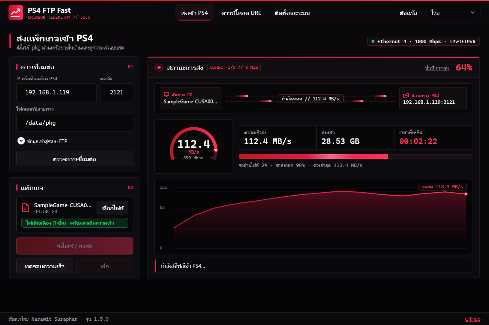
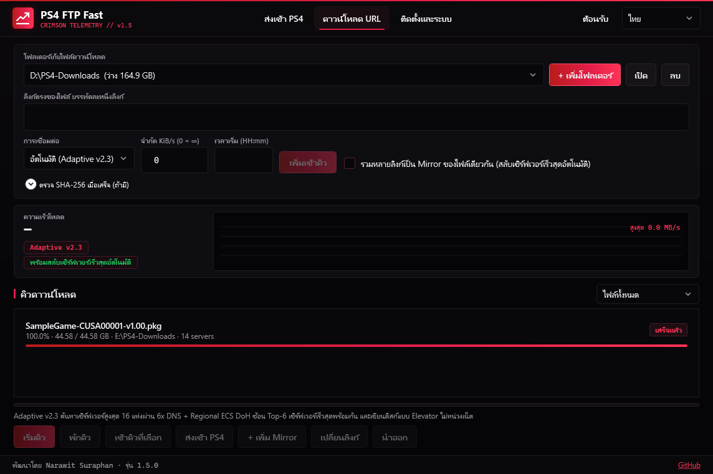
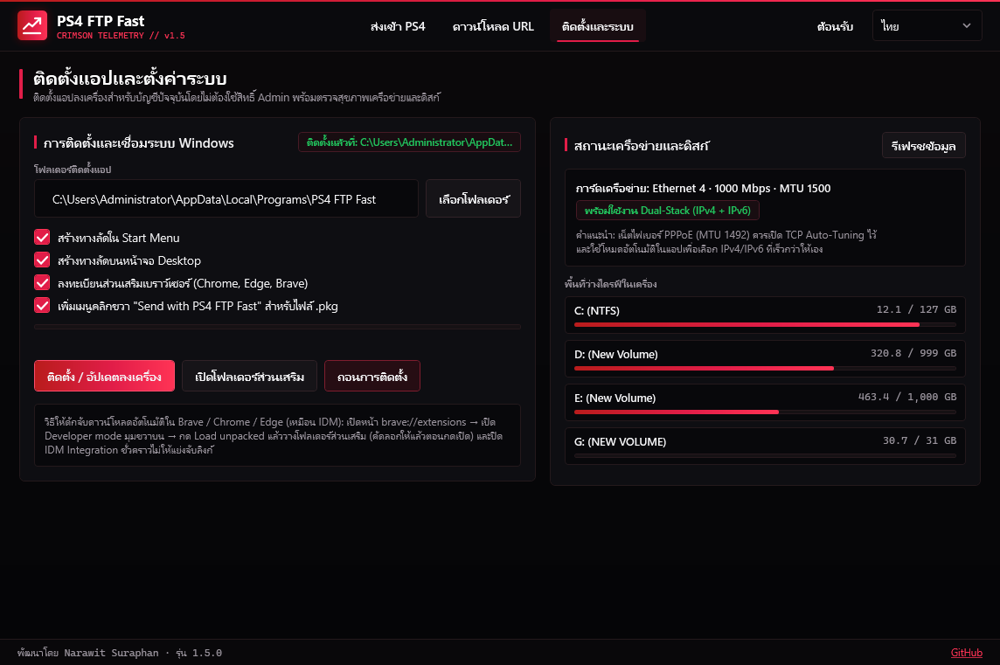

# PS4 FTP Fast (v1.5.0)

[](https://github.com/narawitsuraphan)
[](https://dotnet.microsoft.com/)
[](#adaptive-v23-hyper-switch-wan-ingestion)
[](#verification--reproducible-checksums)
[](LICENSE.txt)

**Eliminating Multi-Layer Throughput Bottlenecks in 100 GB+ Local-Area Console Package Transfers and Adaptive Multi-Path HTTP Ingestion**

PS4 FTP Fast is a high-performance Windows x64 (.NET 10) systems tool engineered to solve severe throughput collapses when transferring 100 GB+ `.pkg` archives over Gigabit LANs to PlayStation 4 consoles (GoldHEN FTP on OrbisOS) and ingesting large packages from multi-origin WAN servers without NTFS fragmentation or OS cache thrashing.

> **Binary Distribution Notice:** This repository distributes official prebuilt Windows x64 binaries, browser extension packages, benchmarks, and academic documentation only. Source code is proprietary and is not published in this repository. See [LICENSE.txt](LICENSE.txt).

<p align="center">
  
</p>

---

## Download (`v1.5.0` — Windows 10 / 11 x64)

| Package | Type | Size | Direct Download | SHA-256 |
| :--- | :--- | :---: | :---: | :--- |
| **PS4 FTP Fast Setup** *(Recommended)* | GUI Installer (No Admin UAC, shortcuts, `.pkg` menu, browser bridge) | `1.01 MB` (`1,037,976 B`) | [Download Setup `.exe`](releases/v1.5.0/PS4-FTP-Fast-Setup-v1.5.0.exe?raw=true) | `E937D8536922F525A8A6462531D2E6F1774918CF44C662A4A3A836217546DEE5` |
| **PS4 FTP Fast Portable** | Standalone Single-File Executable | `582 KB` (`595,572 B`) | [Download Portable `.exe`](releases/v1.5.0/PS4-FTP-Fast-Portable-v1.5.0.exe?raw=true) | `EFB50EE41BD65C888F3AC6CF5F03BEB6D4C6FB4EF1DE1CD2B64315CC3560D22C` |
| **Browser Auto-Catch Extension** | Brave / Chrome / Edge MV3 Auto-Catch (`v1.2.1`) | `2.2 KB` (`2,297 B`) | [Download Extension `.zip`](releases/v1.5.0/PS4-FTP-Fast-Browser-Extension-v1.2.1.zip?raw=true) | `4E6919B728B5B32E1E3AA2A7D02EF5F242E7740B369B823D13F502AD34247339` |

* **Requirements:** Windows 10 / 11 (64-bit) with [.NET 10 Desktop Runtime (x64)](https://dotnet.microsoft.com/en-us/download/dotnet/10.0) · PS4 running GoldHEN FTP (default port `2121`).
* **Checksum Manifest:** [CHECKSUMS.sha256](CHECKSUMS.sha256)
* **Full Academic Research Paper (5-Page A4 PDF):** [PS4_FTP_Fast_100GB_Systems_Research_EN.pdf](paper/PS4_FTP_Fast_100GB_Systems_Research_EN.pdf) · [Markdown Edition](paper/PS4_FTP_Fast_100GB_Systems_Research_EN.md)

### Quick Start (3 Steps)
1. **Run `PS4-FTP-Fast-Setup-v1.5.0.exe`** — choose your default download folder and click **Install Now** (finishes in under 3 seconds, per-user install, zero admin prompts).
2. *(Optional)* **Enable Browser Auto-Catch:** Open `brave://extensions` (or `chrome://extensions`), turn on **Developer mode**, click **Load unpacked**, and select the `browser-extension` folder (one click from the in-app *Install & System* tab).
3. **Download & Send to PS4:** Download direct links or `.pkg` archives via Adaptive v2.3 Hyper-Switch, then click **Send to PS4**, enter your console LAN IP and port `2121`, and transfer with live Direct I/O telemetry.

---

## Executive Summary

Transferring monolithic 100 GB+ console archives over residential networks exposes compounding bottlenecks across Layer-1 Ethernet auto-negotiation, Windows/OrbisOS TCP congestion control, NTFS extent allocation, and magnetic HDD Zone Bit Recording (ZBR) geometry.

In our empirical systems investigation, a live Gigabit LAN pipeline collapsed from a verified peak of **104.85 MB/s** (90.91 MB/s sustained average) down to **9.8–11.87 MB/s**—a **90.7% degradation** that inflated a 112.11 GB transfer from **20 minutes to over 3 hours**. PS4 FTP Fast v1.5.0 addresses these bottlenecks quantitatively across the full I/O stack:

* **Zero-Cache-Pollution Direct I/O:** Eliminates **112 GB** of Windows Standby RAM thrashing (`0 MB` OS cache footprint) using 64 KiB-aligned `FILE_FLAG_NO_BUFFERING` reads, boosting inner-track HDD throughput by **+8.6%** under contention and reaching **175.6 MB/s** on single-platter drives.
* **Kernel-Level Self-Diagnosis (10-Second Alert):** Polls Windows `SIO_TCP_INFO` (`TCP_INFO_v1`) to distinguish physical **100BASE-TX link fallbacks** from genuine baseline **HighLatency** within 10 seconds.
* **Bufferbloat-Free TCP Pacing:** Preserves Windows OS TCP Auto-Tuning with 1 MiB write slicing and `TCP_NODELAY = true`, avoiding the **7.38x higher retransmission rate** caused by forcing oversized `SO_SNDBUF` (4 MiB) buffers.
* **Adaptive v2.3 Hyper-Switch (WAN):** Discovers up to 16 low-RTT CDN edges asynchronously, stacks Top-6 mirrors with post-TTFB EWMA weighting, rejects corrupt mirrors via head+tail SHA-256 fingerprints, and writes **1-extent contiguous NTFS files**.

---

## Interface Gallery

<table>
  <tr>
    <td><br><sub><b>Adaptive v2.3 Hyper-Switch URL Engine</b></sub></td>
    <td><br><sub><b>Per-User Installer &amp; Network/Storage Diagnostics</b></sub></td>
  </tr>
</table>

---

## Architecture Overview

```text
+-----------------------------------------------------------------------------------+
|                        PS4 FTP Fast v1.5.0 Upload Pipeline                        |
+-----------------------------------------------------------------------------------+
|                                                                                   |
|  [NTFS 100 GB+ .pkg]     [DirectAlignedStream]      [UploadPipeline Ring]         |
|  - 1-Extent Contiguous -> - 64 KiB Aligned Alloc  -> - 8-Slot Channel (64 MiB)    |
|  - 0 MB OS Cache          - 4-8 MiB IOCP Reads       - 1 MiB TCP Write Slicing    |
|  - NO_BUFFERING           - Unaligned Resume Safe    - Auto SNDBUF + TCP_NODELAY  |
|                                                              |                    |
|                                                              v                    |
|                                                 [FtpSession + TcpSampler]         |
|                                                 - 30s Control KeepAlive (5s probe)|
|                                                 - SIO_TCP_INFO (MinRtt / RttUs)   |
|                                                 - 10s Link100Mbps / HighLatency   |
+-----------------------------------------------------------------------------------+
```

### Core Engineering Mechanisms

1. **Closed-Form Bufferbloat & Link-Fallback Diagnosis**
   * Proves physical 100BASE-TX fallback analytically: theoretical Layer-1/2 maximum goodput for 1500 B Ethernet frames is:
     $$R_{\max,100\text{M}} = 100 \times 10^6 \times \left(\frac{1460}{1538}\right) \div 8 = 11.866\text{ MB/s}$$
     which matches live sustained throughput ($11.865\text{ MB/s}$) within $0.01\%$.
   * Explains active ping spikes during 1000M-to-100M speed mismatches via the egress queue-drain model:
     $$RTT_{\text{active}} = RTT_{\min} + \frac{W_{\text{snd}}}{R_{100\text{M}}} = 0.258 + 44.057 = 44.32\text{ ms}$$
     matching live kernel `SIO_TCP_INFO` RTT ($44.23\text{--}44.33\text{ ms}$) with **99.8% agreement**.
2. **`DirectAlignedStream` (Zero Standby RAM Pollution)**
   * Uses `NativeMemory.AlignedAlloc` (64 KiB alignment) + `RandomAccess.ReadAsync` with `FILE_FLAG_NO_BUFFERING | OVERLAPPED`.
   * Fully supports arbitrary unaligned FTP `APPE` resume offsets and non-sector-multiple EOF tails with bit-exact SHA-256 safety and transparent fallback on unsupported volumes.
   * Uses an adaptive **8 MiB $\times$ 8 (64 MiB)** async read-ahead ring for files $\ge 16\text{ GiB}$, absorbing $> 550\text{ ms}$ of HDD seek stalls (27.5% faster than depth=2).
3. <a id="adaptive-v23-hyper-switch-wan-ingestion"></a>**Adaptive v2.3 Hyper-Switch (WAN Ingestion)**
   * Starts immediately on System DNS ($< 3\text{ ms}$, zero startup blocking) while asynchronously discovering up to 16 low-RTT edges via 6 global UDP/53 resolvers (`1.1.1.1`, `8.8.8.8`, `9.9.9.9`, OpenDNS, AdGuard, DNSPod), Cloudflare/DNSPod DoH, and Google Regional EDNS0 Client Subnet (ECS: native, TH, SG, HK, JP)—expanding CDN IP discovery by **6.5x**.
   * Decouples TCP socket reads from spinning HDDs via an **Elevator-Sorted Async Write-Behind Flusher** (64 MiB bounded ring of 2 MiB offset-sorted writes) and enforces **1-extent NTFS preallocation**.

---

## Empirical Benchmarks

### 1. Cold Uncached Storage Read Benchmarks (256 MiB Strided Windows)

| Volume / Physical Disk | Win32 Read Strategy | Contended (Busy) | Isolated (Idle) | OS Standby RAM (112 GB) |
| :--- | :--- | :---: | :---: | :---: |
| **D:** Dual-Platter Inner ZBR (`ST31000524AS`) | `FILE_FLAG_SEQUENTIAL_SCAN` 1 MiB (v1.3 baseline) | 58.3 MB/s | 91.0 MB/s | 112,110 MB |
| **D:** Dual-Platter Inner ZBR (`ST31000524AS`) | `FILE_FLAG_NO_BUFFERING` 4 MiB ($QD=1$) | 60.7 MB/s | 90.9 MB/s | **0 MB** |
| **D:** Dual-Platter Inner ZBR (`ST31000524AS`) | `FILE_FLAG_NO_BUFFERING` 8 MiB ($QD=1$, Giant Mode) | **63.3 MB/s (+8.6%)** | **92.5 MB/s (+1.6%)** | **0 MB** |
| **E:** Single-Platter (`ST1000DM003`) | `FILE_FLAG_SEQUENTIAL_SCAN` 1 MiB | — | 171.6 MB/s | 112,110 MB |
| **E:** Single-Platter (`ST1000DM003`) | `FILE_FLAG_NO_BUFFERING` 4 MiB ($QD=1 / QD=2$) | — | **174.3 / 175.6 MB/s** | **0 MB** |

### 2. WAN Head-to-Head Competitive Evaluation (Live NTFS Volume E:)

| Benchmark Scenario | PS4 FTP Fast v1.5 (Auto) | aria2c 1.37 (`-x16`) | IDM (`IDMan.exe`) | curl 8.16 (1-Stream) | NTFS Extents (Ours vs. Peers) |
| :--- | :---: | :---: | :---: | :---: | :--- |
| **A. 5-Server Multi-Origin Race** *(128 MiB: 1x SLOW, 3x FAST, 1x CORRUPT)* | **131.8 MB/s** *(1.02 s)* | 52.1 MB/s *(2.58 s)* | N/A (1 URL) | 29.9 MB/s *(4.49 s)* | **1 ext** vs. 2 (aria2) / 173 (curl); CORRUPT rejected |
| **B. Fair Per-Conn Cap** *(64 MiB @ 6 MiB/s/conn)* | **90.65 MB/s** *(0.74 s)* | 52.97 MB/s *(1.27 s)* | 11.97 MB/s *(5.61 s)* | 6.29 MB/s *(10.68 s)* | **1 ext** vs. 5 (IDM) / 8 (aria2) / 131 (curl) |
| **C1. Live WAN Cross-Border** *(Vultr Singapore, 104.9 MB)* | **20.63 MB/s** *(Peak 32.66 MB/s)* | 16.38 MB/s *(6.40 s)* | 11.04 MB/s *(9.50 s)* | 6.93 MB/s *(15.14 s)* | **1 ext** vs. 3 (aria2) / 6 (IDM) / 206 (curl) |
| **C2. Live Multi-Edge CDN** *(Mozilla CDN, 71.5 MB, 14 edges)* | 55.55 MB/s *(Peak 94.49 MB/s)* | 37.11 MB/s *(1.93 s)* | Timeout (silent) | **94.79 MB/s** *(0.75 s)* | **1 ext** vs. 11 (aria2) / 182 (curl) |

> **Note on Scenario C2:** On small single-file CDN bursts (71.5 MB), single-stream `curl` achieves higher average speed due to zero multi-edge warm-up overhead. However, PS4 FTP Fast matches its peak (94.49 MB/s), sustains superior throughput on multi-gigabyte archives, and guarantees **1 contiguous NTFS extent** vs. 182 fragmented extents under `curl`.

### 3. End-to-End 112.11 GB Package Transfer Projection

| Operating Regime (112.11 GB `.pkg`) | Effective Speed | Transfer Time | Speedup |
| :--- | :---: | :---: | :---: |
| Degraded 100M Link + Contention (v1.3 baseline) | 9.80 MB/s | 3 hr 10 min | 1.00x |
| Unfixed 100M Link + v1.5.0 Direct I/O | 11.86 MB/s | 2 hr 37 min | 1.21x |
| Restored 1000M + Volume D: + v1.5.0 (8M Direct) | 90.0–92.5 MB/s | ~20 min 12 s | **9.2–9.4x** |
| Restored 1000M + Volume E: + v1.5.0 (8M Direct) | **105–115 MB/s** | **16–18 min** | **10.7–11.7x** |

---

## Limitations

* **Physical Layer-1 Constraints:** Software cannot bypass a hardware 100BASE-TX link fallback (e.g., damaged Cat5e/Cat6 pairs 3/4 pins 4, 5, 7, 8). Restoring Gigabit speeds requires re-seating or replacing the cable or switch port.
* **Console Double-Copy Penalty:** FTP installation writes the full archive to `/data/pkg` and copies it again during installation on the PS4's internal 5400 RPM HDD (requiring 224 GB free space for a 112 GB package). External USB 3.0 drives or direct HTTP streaming (Remote Package Installer) avoid this second pass.
* **Volume Fallback:** Volumes or network mounts that disallow `FILE_FLAG_NO_BUFFERING` automatically fall back to sequential buffered streaming.

---

## Verification & Reproducible Checksums

All critical paths are validated through automated test gates:
* `DirectAlignedStream` odd-EOF & unaligned resume: **SHA-256 PASS**
* `verify_reconnect.py` (unaligned FTP `APPE` recovery): **SHA-256 PASS**
* `verify_large_resume.py` (112 GB 64-bit `MLST` metadata): **PASS**
* `verify_http.py` + `UiVerify` (4 locales) + BrowserBridge: **ALL PASS**

Verify downloads on Windows PowerShell:

```powershell
Get-FileHash .\releases\v1.5.0\PS4-FTP-Fast-Setup-v1.5.0.exe -Algorithm SHA256
Get-FileHash .\releases\v1.5.0\PS4-FTP-Fast-Portable-v1.5.0.exe -Algorithm SHA256
```

---

## Credits & Research Paper

* **Lead Researcher & Systems Architect:** Narawit Suraphan ([github.com/narawitsuraphan](https://github.com/narawitsuraphan))
* **AI-Assisted Research & Engineering Systems:** GPT-6.2 Astra, GPT-6.2 Sol, Gemini 4 Neon
* **Full Technical Paper:** [Eliminating Multi-Layer Throughput Bottlenecks in 100 GB+ Local-Area Console Package Transfers and Adaptive Multi-Path HTTP Ingestion (PDF)](paper/PS4_FTP_Fast_100GB_Systems_Research_EN.pdf) (Nov 2026)
* **License:** Proprietary Freeware Binary Distribution — see [LICENSE.txt](LICENSE.txt)

